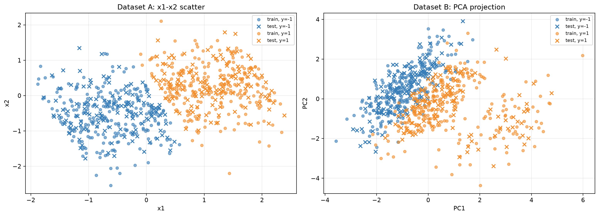
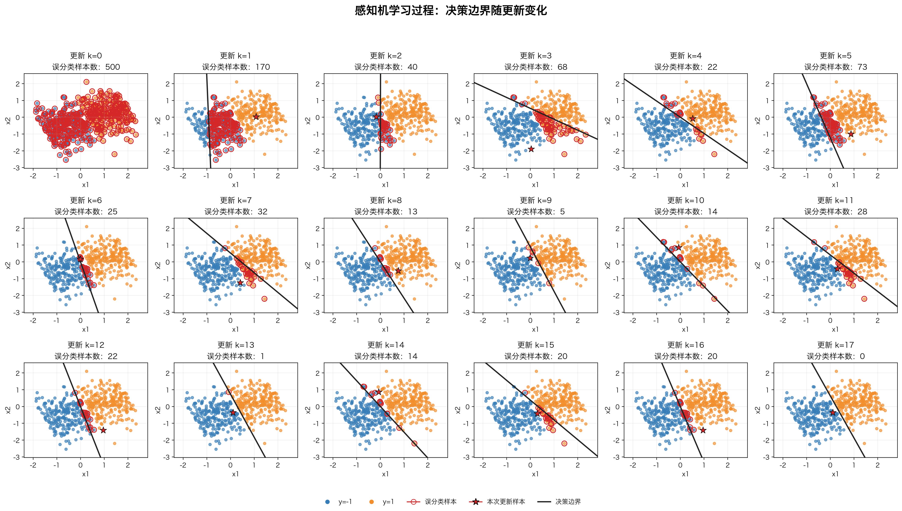
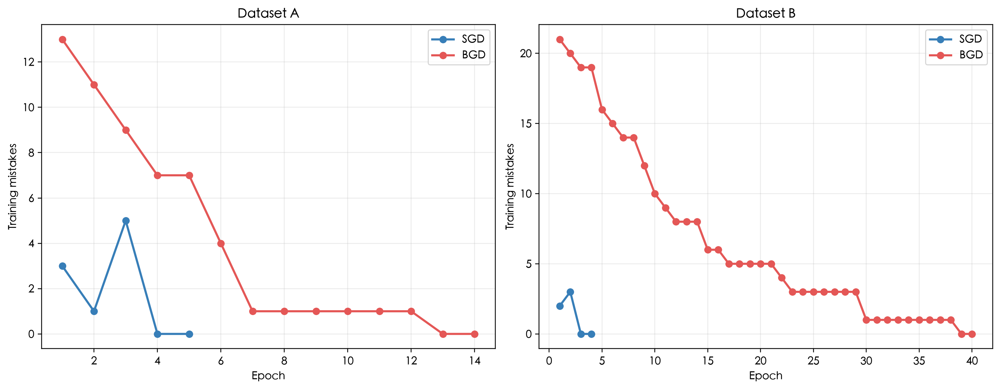
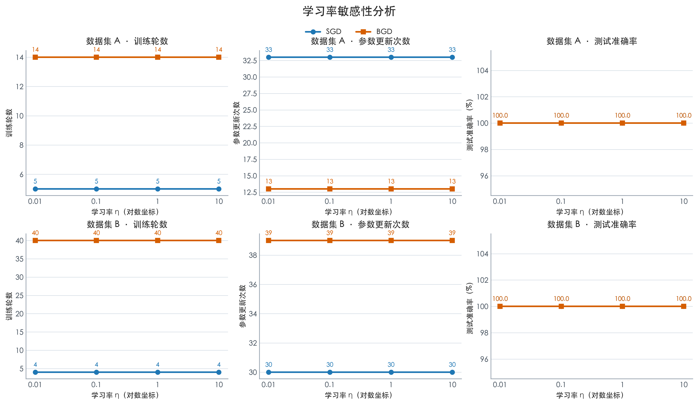
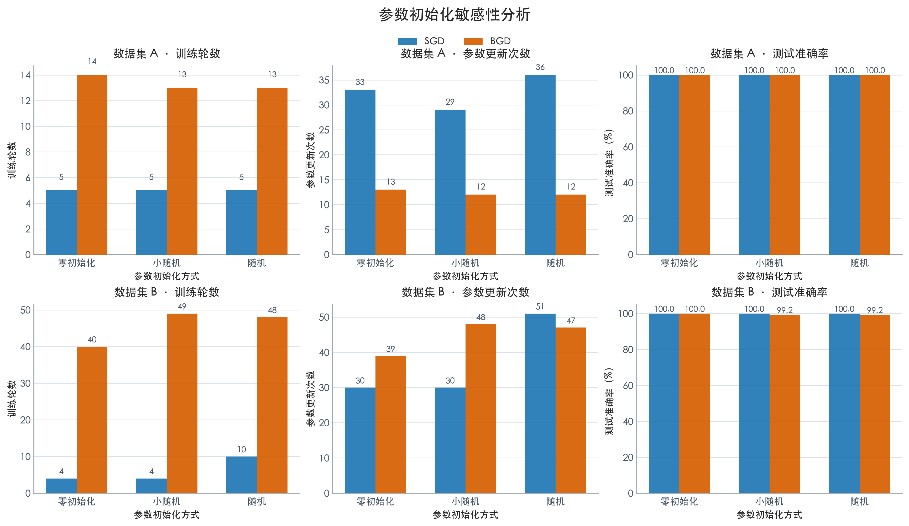
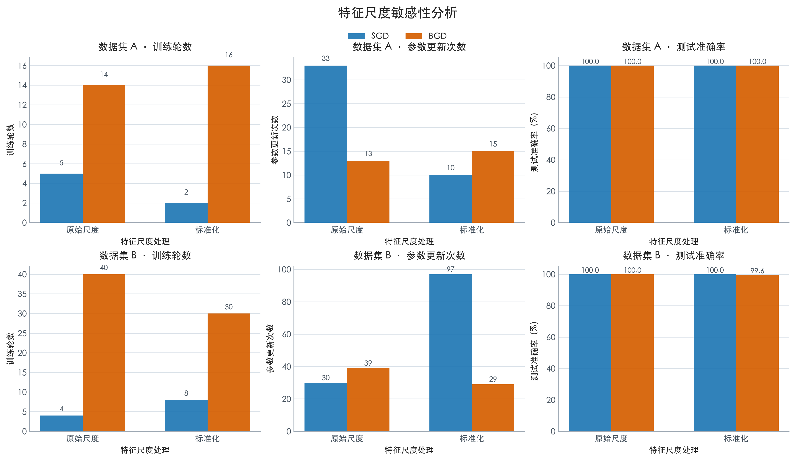
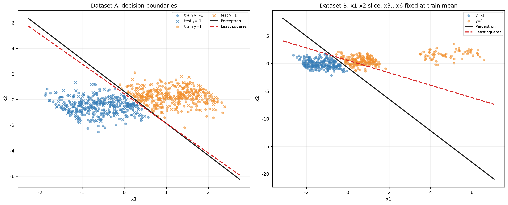
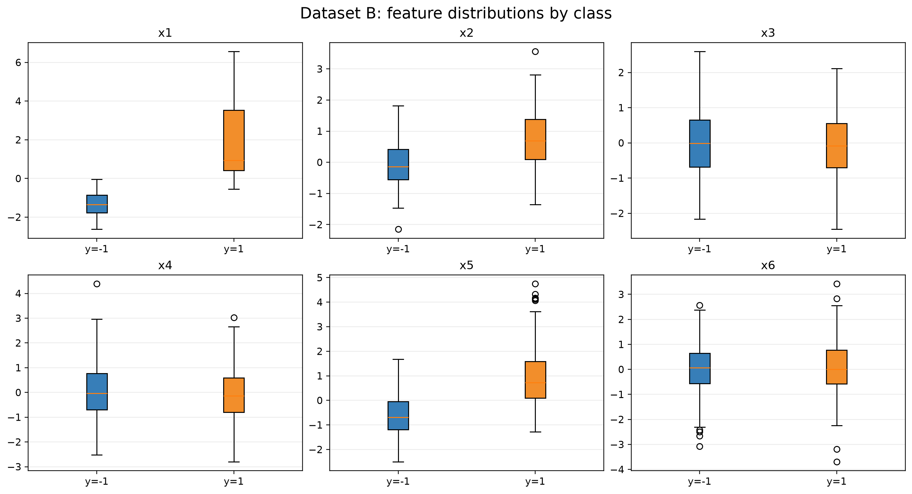
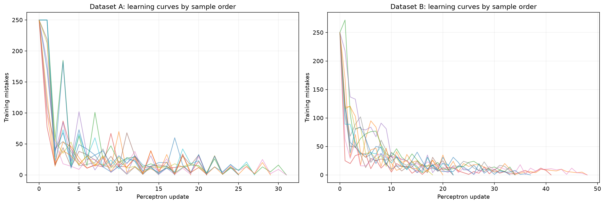
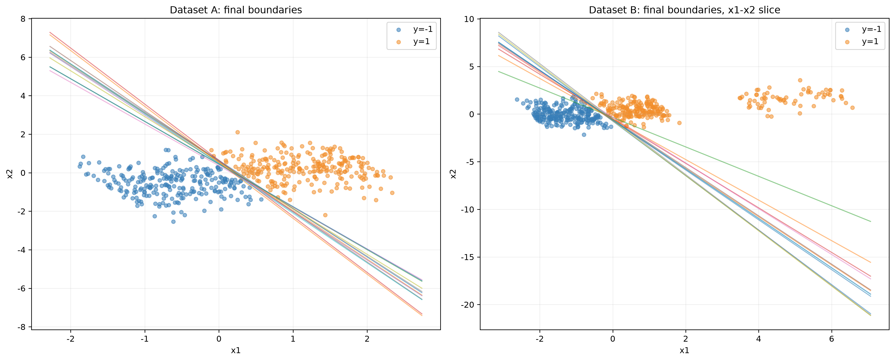

一、问题重述与问题分析
1.1 问题重述
第一部分通过**可视化**研究感知机的**学习过程**；
第二部分比较**逐样本更新**与**全批量优化**，并考察**实验设置**对训练行为的影响；
第三部分使用线性回归完成分类任务，与感知机进行比较，进一步研究**决策边界的不唯一性**。

1.2 问题分析

问题一要求**研究感知机的学习过程与决策边界演化。** 首先使用数据集A训练感知机分类模型；再利用连续图像展示模型训练过程的**决策边界的变化**，主要可视化方向为：随着迭代步骤的进行，决策边界的变动，展现每次模型参数更新后分类的效果。在做完上一步骤后，需要根据记录下来的参数变化记录，完成以下任务：（1）结合参数更新记录，确认参数调整与分类结果之间的规律；（2）针对训练过程中的特殊现象进行分析，给出解释和验证。

问题二要求**比较感知机的逐样本更新与全批量优化。** 即比较批量梯度下降和随机梯度下降，需要完成的任务是：
（1）分别推导并实现感知机模型逐样本更新和全批量迭代更新方法，给出两种算法的参数更新公式及完整步骤，并结合数学理论讨论它们的收敛性质；
（2）分别在A、B两个数据集上，使用随机梯度下降和批量梯度下降训练感知机，并比较结果
完成后再围绕学习率、参数初始化及特征尺度进行灵敏度分析。

问题三要求**比较线性回归与感知机的分类结果。** 因此在数据集 A、B 上分别建立感知机分类器与最小二乘线性回归分类器，共有四类情况需要对比。针对线性回归分类，标签直接用现有的 +1 / - 1来直接训练即可。最后需要给出四个模型表达式，比较训练集和测试集的分类效果，需要根据数据解释为什么会出现这样子的效果。此外还有额外实验：固定数据集及其他训练条件，仅改变**感知机**的样本访问顺序开展重复实验。这里需要比较**学习过程**、**最终决策边界**及分类表现，再提出合适的量化方法进行分析。

二、感知机学习过程与决策边界演化
2.1 数据预处理
在模型训练之前，首先对数据集 A 和数据集 B 进行基本质量检查。具体而言，读取两个数据集后，本文分别统计了其样本数量、特征维度、数据类型、缺失值数量、重复样本数量以及类别分布情况。

检查结果表明，数据集 A 的训练集和测试集分别包含 500 个和 250 个样本，共有 2 个数值特征；数据集 B 的训练集和测试集分别包含 500 个和 250 个样本，共有 6 个数值特征。两个数据集的训练集和测试集中均未发现缺失值或重复样本。此外，两个数据集的正负样本数量均保持平衡，说明类别比例不存在明显偏斜。上述检查结果表明，数据集可以进行后续实验，无需进行缺失值填补、重复样本删除等额外清洗操作。

针对数据集 A，由于其仅包含两个特征，因此直接绘制 $x_1-x_2$ 二维散点图。图中使用不同颜色表示正负类别，并使用不同点形区分训练集与测试集。针对数据集 B ，由于包含 6 个特征，无法直接在二维平面中展示其完整结构。为便于观察其整体分布，首先对训练集进行标准化，再根据标准化后的数据进行PCA主成分分析，并绘制 PCA 二维投影图。

如图所示，数据集 A 的两类样本呈现明显的分离趋势，即具有较明显的线性分类结构；而由数据集B 的 PCA 二维投影图以及 PCA 主成分分析结果可知， 蓝色样本整体偏向 PC1 的左侧，橙色样本整体偏向 PC1 的右侧，说明数据中可能存在与类别相关的主要变化方向。
数据预处理代码如下：

2.2 感知机模型建立与求解流程
感知机是一种用于二分类的线性模型。给定线性可分的训练数据集：
$$D=\{(x_i,y_i)\}_{i=1}^{N}, \qquad y_i\in\{-1,1\}$$
感知机建立一个线性分类模型：
$$F(x)=\operatorname{sign}(w\cdot x+b)$$
其中，$w$ 为权重向量，$b$ 为偏置项。模型的决策边界为：
$$w\cdot x+b=0$$
模型求解采用逐样本更新方式，学习率为 $0<\eta\leq1$ 。首先选择初始参数 $w^{(0)}$ 和 $b^{(0)}$，代码中选择先将二者初始化为零向量和零值。随后按照训练集中的固定顺序选取样本 $(x_i,y_i)$，计算该样本的分类间隔：
$$y_i\left(w^{(k)}\cdot x_i+b^{(k)}\right) $$
如果：
$$y_i\left(w^{(k)}\cdot x_i+b^{(k)}\right)\leq0$$
则说明该样本被误分类或位于决策边界上，此时更新模型参数：
$$w^{(k+1)} = w^{(k)}+\eta y_i x_i,\quad b^{(k+1)} = b^{(k)}+\eta y_i$$
完成一次参数更新后，将更新次数记为 $k=k+1$，然后返回训练集的第一个步骤，继续按照固定顺序检查样本。如果当前样本已经被正确分类，则不改变参数，直接检查下一个样本。

当完整遍历训练集后不再存在满足 $y_i(w\cdot x_i+b)\leq0$ 的误分类样本时，训练过程结束，并将当前参数作为最终模型参数：
$$\hat w=w^{(k)},\qquad \hat b=b^{(k)}$$
最终得到的感知机分类器为：
$$F(x)=\operatorname{sign}(\hat w\cdot x+\hat b)$$
模型建立和求解代码如下：

2.3  求解结果分析
在数据集 A 上，感知机按照逐样本更新规则进行训练。模型初始化为 $w^{(0)}=0$、$b^{(0)}=0$，学习率设置为 $\eta=1$，并在每次发现误分类样本时立即更新参数。为直观展示模型的求解过程，记录了每次参数更新后的决策边界、误分类样本数量以及测试集分类准确率。

2.3.1  感知机决策边界变化与参数分析

在数据集 A 上通过上述感知机算法求解分类器方程，得到决策边界随参数更新的变化如下图所示：

如图所示，每个子图表示一次参数更新后的模型状态，其中黑色直线表示当前决策边界，红色空心圆表示当前仍然被误分类的样本，红色五角星表示触发本次参数更新的样本。在初始状态下 k = 0，此时所有样本的判别函数值均为 0，根据误分类判定条件，所有样本都被视为需要处理，因此图中显示误分类样本数为 500。此时模型还没有形成具有实际意义的决策边界。

第一次遇到误分类样本后，感知机根据该样本的特征和标签调整权重与偏置，决策边界开始出现。随着更新次数增加，决策边界不断发生平移和旋转，并逐渐从样本混合区域移动到两类样本之间。

从图中可见，误分类样本数总体呈下降趋势，但并不是每次更新后都下降。例如：

- 第 3 次更新后误分类数从 40 增加到 68；
- 第 5 次更新后从 22 增加到 73；
- 第 13 次更新后误分类数已经降到 1，但第 14 次更新后又增加到 14；
- 第 17 次更新后误分类数最终降为 0。

这种波动是感知机逐样本更新的正常现象。感知机每次只根据一个误分类样本调整参数，虽然能够纠正当前样本，但新的决策边界也可能使其他样本暂时被分错。因此，训练过程中的误分类数量不一定单调下降。

经过 17 次参数更新后，训练集中不再存在误分类样本，说明数据集 A 可以被一个线性超平面完全分开。本次训练得到的最终参数为：
$$ w=(3.946627,\ 1.574468)^T$$
$$b=-1$$
因此，最终感知机分类器为：
$$\hat y= \operatorname{sign} \left( 3.946627x_1+ 1.574468x_2-1 \right)$$
对应的决策边界为：
$$3.946627x_1+ 1.574468x_2-1=0$$
最终训练集和测试集的分类准确率均为 100%，说明该决策边界不仅正确分开了训练样本，也能够正确分类测试样本。

2.3.2  参数调整和分类结果联系
感知机的参数更新公式为：
$$w^{(k+1)}=w^{(k)}+\eta y_i x_i$$
$$b^{(k+1)}=b^{(k)}+\eta y_i$$
本实验中 $\eta=1$，因此每次更新的参数变化量完全由当前误分类样本的特征和标签决定。权重向量 $w$ 决定决策边界的方向，偏置 $b$ 决定决策边界的位置。

为了具体分析参数变化与分类结果之间的关系，考察第 3 次参数更新。第 3 次更新之前，模型参数为：
$$w^{(2)}=(1.257202,-0.002445)^T,\qquad b^{(2)}=0$$

此时被选中的样本为：

$$x_{25}=(0.028616,-1.897200)^T,\qquad y_{25}=-1$$

该样本的分类间隔为：

$$y_{25}\left(w^{(2)T}x_{25}+b^{(2)}\right) =-0.040615<0$$

因此该样本被误分类，需要进行更新。根据感知机更新公式：

$$\Delta w =y_{25}x_{25} =(-0.028616,1.897200)^T $$$$\Delta b=y_{25}=-1$$

更新后得到：

$$w^{(3)}=(1.228586,1.894755)^T,\qquad b^{(3)}=-1$$

此时该样本的分类间隔变为：

$$y_{25}\left(w^{(3)T}x_{25}+b^{(3)}\right) =4.559573>0 $$

说明第 3 次更新成功纠正了当前被选中的样本。

但是，这次更新同时使决策边界发生了较大的移动。更新前的权重中 $w_2$ 接近 0，决策边界接近竖直方向；更新后 $w_2$ 增加到 1.894755，决策边界明显发生旋转。更新前后的决策边界分别近似为：

$$1.257202x_1-0.002445x_2=0$$
$$1.228586x_1+1.894755x_2-1=0 $$

因此，感知机并不是只改变当前样本的分类结果，而是会同时改变所有样本的判别函数值。

对于任意其他样本 $x_j$，这次更新造成的判别函数变化为：

$$f_{\text{new}}(x_j)-f_{\text{old}}(x_j) = \Delta w^Tx_j+\Delta b = y_{25}(x_{25}^Tx_j+1)$$

例如，样本 A_TRAIN_0028 的标签为 $+1$，其更新前后的分类间隔分别为：

$$ m_{\text{old}}=0.659229>0 $$$$ m_{\text{new}}=-0.499538<0$$
也就是说，这个样本在更新前被正确分类，但由于第 3 次更新导致决策边界移动，它在更新后被错误分类。从整个训练集来看，第 3 次更新前有 40 个误分类样本，更新后误分类数增加到 68 个。进一步检查可以发现：
- 原来的 40 个误分类样本全部被纠正；
- 同时有 68 个原本正确的样本变成误分类；
- 因此误分类总数由 40 增加到 68。

测试集准确率也从更新前的 90.4% 降低到更新后的 89.2%。这验证了图中误分类样本数出现波动的原因：感知机每次只针对一个误分类样本更新，但参数变化会影响整个数据集。

后续更新继续纠正这些新产生的误分类样本。虽然在第 4～16 次更新过程中，误分类数量仍然出现了多次上升和下降，但最终在第 17 次更新后，训练集误分类数降为 0，训练集和测试集准确率均达到 100%。

因此，本实验说明感知机的学习过程具有以下特点：

1. 每次参数更新都能改善当前被选中的误分类样本，但是单次更新不保证全局误分类数量下降；
2. 经过有限次更新，模型最终会找到能够同时满足所有训练样本的分类边界。

三、感知机逐样本更新与全批量优化对比分析

3.1 两种求解算法对比

3.1.1  算法求解过程与参数更新公式推导

设训练集为：
$$D=\{(x_i,y_i)\}_{i=1}^{N},\qquad y_i\in\{-1,1\}$$

将偏置项并入特征向量，记：
$$\tilde{x}_i=\begin{bmatrix}x_i\\1\end{bmatrix},\qquad
\theta=\begin{bmatrix}w\\b\end{bmatrix}$$

此时感知机的判别函数为：
$$f(x_i)=w\cdot x_i+b=\theta^T\tilde{x}_i$$

样本的分类间隔为：
$$m_i^{(k)}=y_i\left(w^{(k)}\cdot x_i+b^{(k)}\right)$$

当 $m_i^{(k)}\leq0$ 时，样本被误分类或位于决策边界上。本文按照感知机准则，对当前误分类样本定义损失：
$$\ell_i^{(k)}=-y_i\left(w^{(k)}\cdot x_i+b^{(k)}\right),\qquad i\in M_k$$

其中：
$$M_k=\left\{i:y_i\left(w^{(k)}\cdot x_i+b^{(k)}\right)\leq0\right\}$$

因此，第 $k$ 次迭代的批量准则函数为：
$$L^{(k)}(w,b)=-\sum_{i\in M_k}y_i\left(w\cdot x_i+b\right)$$

正确分类的样本不参与当前轮次的损失和更新。这里直接使用 $-y_i(w\cdot x_i+b)$，不采用带有 $\max$ 的替代表达式。

对于逐样本更新方法，在当前误分类样本 $i$ 上有：
$$\frac{\partial \ell_i}{\partial w}=-y_i x_i,\qquad
\frac{\partial \ell_i}{\partial b}=-y_i$$

按照梯度下降方向更新：
$$w^{(k+1)}=w^{(k)}-\eta\frac{\partial \ell_i}{\partial w}
=w^{(k)}+\eta y_i x_i$$

$$b^{(k+1)}=b^{(k)}-\eta\frac{\partial \ell_i}{\partial b}
=b^{(k)}+\eta y_i$$

逐样本更新的完整步骤如下：

1. 初始化 $w^{(0)}$ 和 $b^{(0)}$，设置学习率 $\eta>0$；
2. 选取一个训练样本 $(x_i,y_i)$；
3. 计算分类间隔 $m_i^{(k)}$；
4. 若 $m_i^{(k)}\leq0$，按照上式更新 $w$ 和 $b$；若 $m_i^{(k)}>0$，保持参数不变；
5. 遍历完训练集后，若本轮没有发生更新，则停止训练；否则进入下一轮。

本实验中的逐样本方法在每个训练周期内使用一个随机排列的样本顺序，因此属于随机梯度下降式的逐样本更新。

对于全批量更新方法，在第 $k$ 次迭代中首先计算全部训练样本的间隔，并构造误分类集合 $M_k$。批量准则函数的梯度为：
$$\frac{\partial L^{(k)}}{\partial w}=-\sum_{i\in M_k}y_i x_i,\qquad
\frac{\partial L^{(k)}}{\partial b}=-\sum_{i\in M_k}y_i$$

因此全批量更新公式为：
$$w^{(k+1)}=w^{(k)}+\eta\sum_{i\in M_k}y_i x_i$$

$$b^{(k+1)}=b^{(k)}+\eta\sum_{i\in M_k}y_i$$

全批量更新的完整步骤如下：

1. 初始化 $w^{(0)}$ 和 $b^{(0)}$；
2. 扫描整个训练集，计算所有样本的分类间隔；
3. 构造误分类集合 $M_k$；
4. 若 $M_k=\varnothing$，则停止训练；
5. 若 $M_k\neq\varnothing$，汇总所有误分类样本的更新量，并统一更新参数；
6. 返回步骤2，直到误分类集合为空或达到最大迭代次数。

3.1.2  算法收敛性质分析

令 $z_i=y_i\tilde{x}_i$。假设训练集线性可分，存在单位向量 $\theta^*$，使得：
$$\theta^{*T}z_i\geq\gamma>0$$

并设：
$$\|z_i\|\leq R$$

其中 $\gamma$ 为训练集的最小分类间隔，$R$ 为样本向量范数的上界。

对于逐样本更新，每次发生误分类时：
$$\theta^{(k+1)}=\theta^{(k)}+\eta z_i$$

由于当前样本被误分类，有 $\theta^{(k)T}z_i\leq0$。因此：
$$\theta^{(k+1)T}\theta^*
=\theta^{(k)T}\theta^*+\eta z_i^T\theta^*
\geq\theta^{(k)T}\theta^*+\eta\gamma$$

经过 $M$ 次错误更新后：
$$\theta^{(M)T}\theta^*\geq M\eta\gamma$$

另一方面：
$$\begin{aligned}
\|\theta^{(k+1)}\|^2
&=\|\theta^{(k)}\|^2+2\eta\theta^{(k)T}z_i+\eta^2\|z_i\|^2\\
&\leq\|\theta^{(k)}\|^2+\eta^2R^2
\end{aligned}$$

因此：
$$\|\theta^{(M)}\|^2\leq M\eta^2R^2$$

由柯西不等式：
$$M\eta\gamma\leq\|\theta^{(M)}\|$$

可得：
$$\boxed{M\leq\frac{R^2}{\gamma^2}}$$

这说明在线性可分条件下，逐样本更新方法经过有限次错误更新后能够停止。样本访问顺序会影响实际更新次数和最终参数，但不改变其有限收敛性质。

对于全批量更新，设第 $k$ 次批量更新中的误分类样本数为 $m_k=|M_k|$，并记：
$$g_k=\sum_{i\in M_k}z_i$$

此时：
$$\theta^{(k+1)}=\theta^{(k)}+\eta g_k$$

在正确分类方向上的投影满足：
$$\theta^{(k+1)T}\theta^*
\geq\theta^{(k)T}\theta^*+\eta m_k\gamma$$

令 $K$ 为批量参数更新次数，并令：
$$S=\sum_{k=0}^{K-1}m_k$$

其中 $S$ 是所有批量迭代中误分类样本参与更新的累计次数，则：
$$\theta^{(K)T}\theta^*\geq\eta\gamma S$$

又因为每个误分类样本满足 $\theta^{(k)T}z_i\leq0$，所以：
$$\begin{aligned}
\|\theta^{(k+1)}\|^2
&=\|\theta^{(k)}\|^2+2\eta\theta^{(k)T}g_k+\eta^2\|g_k\|^2\\
&\leq\|\theta^{(k)}\|^2+\eta^2m_k^2R^2\\
&\leq\|\theta^{(k)}\|^2+\eta^2Nm_kR^2
\end{aligned}$$

因此：
$$\|\theta^{(K)}\|^2\leq\eta^2NR^2S$$

由柯西不等式：
$$\eta\gamma S\leq\|\theta^{(K)}\|$$

进一步得到：
$$\eta^2\gamma^2S^2\leq\eta^2NR^2S$$

从而有：
$$\boxed{S\leq\frac{NR^2}{\gamma^2}}$$

由于每次批量更新至少包含一个误分类样本，因此：
$$K\leq S\leq\frac{NR^2}{\gamma^2}$$

这说明全批量方法在线性可分数据上也具有有限收敛性质，但其理论上界比逐样本更新更宽松。全批量方法的每次更新使用整体误分类方向，参数变化更集中，但每轮都要扫描整个训练集，因此单次迭代的计算成本更高。若数据不可线性分离，则两种方法均不能保证有限步达到零误分类，实际训练中需要设置最大迭代次数。

3.2 算法对比实验

学习代码：compare_perceptron_updates.py。实验使用零初始化和学习率 $\eta=1$，在数据集 A、B 上分别训练逐样本更新模型和全批量更新模型。训练集形状为 $500\times4$ 和 $500\times8$，测试集形状为 $250\times4$ 和 $250\times8$。

表3-1 两种更新方法的基准实验结果。

| 数据集 | 方法    | 训练轮数 | 参数更新次数 | 误分类项累计数 | 样本评估次数 | 训练准确率 | 测试准确率 |
| --- | ----- | ---: | -----: | ------: | -----: | ----: | ----: |
| A   | 逐样本更新 |    5 |     33 |      33 |   2500 |  100% |  100% |
| A   | 全批量更新 |   14 |     13 |     557 |   7000 |  100% |  100% |
| B   | 逐样本更新 |    4 |     30 |      30 |   2000 |  100% |  100% |
| B   | 全批量更新 |   40 |     39 |     764 |  20000 |  100% |  100% |

图3-2 A、B 数据集上的训练误分类数变化曲线。横轴为训练轮数，纵轴为当前轮次结束后的训练误分类数。两种方法最终都将训练误分类数降为零；逐样本方法在本实验中的训练轮数和样本评估次数更少，而全批量方法每次更新使用更完整的误分类信息，但需要更多次完整扫描训练集。

从分类结果来看，两种方法在 A、B 两个数据集上均达到 100% 的训练集和测试集准确率，说明数据具有较明显的线性可分结构。从训练代价来看，逐样本方法在 A、B 上分别经过 5 轮和 4 轮训练即可收敛，而全批量方法分别需要 14 轮和 40 轮。需要注意的是，全批量方法的参数更新次数较少，但每次参数更新前都需要检查整个训练集，因此应结合样本评估次数判断计算成本，而不能只比较参数更新次数。

3.3 敏感性分析
在上述实验的基础上，接下来围绕学习率、参数初始化及特征尺度开展系统的敏感性分析。

3.3.1  学习率敏感性分析

实验设置 $\eta\in\{0.01,0.1,1,10\}$，其他条件保持不变。图3-3从训练轮数、参数更新次数和测试准确率三个指标展示学习率变化的影响。

图3-3 学习率敏感性分析。每一行对应一个数据集，每一列分别表示训练轮数、参数更新次数和测试准确率；蓝色圆点表示逐样本更新，橙色方块表示全批量更新。四个学习率下各条曲线基本重合，说明在零初始化和线性可分数据上，学习率主要改变参数的数值尺度，而没有改变误分类样本的判定路径。

实验结果显示，数据集 A 的逐样本方法始终为 5 轮、33 次参数更新，全批量方法始终为 14 轮、13 次参数更新；数据集 B 的逐样本方法始终为 4 轮、30 次参数更新，全批量方法始终为 40 轮、39 次参数更新，测试准确率均为 100%。这是因为零初始化时，增大学习率会使参数更新量成比例放大，但不会改变分类间隔的符号。该结论依赖于当前的零初始化、无正则化和线性可分条件，在非线性可分数据或非零初始化条件下不应简单推广。

3.3.2  参数初始化敏感性分析

比较零初始化、小随机初始化和随机初始化三种方式。图3-4同时给出了训练轮数、参数更新次数和测试准确率，便于观察初始化对训练路径和泛化结果的影响。

图3-4 参数初始化敏感性分析。每一行对应一个数据集，每一列分别表示训练轮数、参数更新次数和测试准确率；柱顶数值为对应实验结果。数据集 A 的三种初始化方式均保持 100% 测试准确率，数据集 B 对初始化更加敏感，尤其是全批量方法的训练轮数和测试准确率出现了变化。

在数据集 A 上，逐样本方法的参数更新次数为 29～36 次，全批量方法为 12～13 次，三种初始化方式的测试准确率均为 100%。在数据集 B 上，逐样本方法从零初始化或小随机初始化的 4 轮增加到随机初始化的 10 轮；全批量方法的训练轮数从零初始化的 40 轮增加到小随机初始化的 49 轮和随机初始化的 48 轮。两种非零初始化下，全批量方法的测试准确率均为 99.2%。这说明初始化会影响最初的决策边界，从而改变后续误分类集合和参数更新方向。

3.3.3  特征尺度敏感性分析

特征尺度表示不同特征的数值范围和波动大小。若某一特征的数值范围明显较大，则更新量 $\eta y_i x_i$ 会更多地受到该特征影响。本文使用训练集均值和标准差进行标准化：
$$x_{ij}^{\prime}=\frac{x_{ij}-\mu_j}{\sigma_j}$$

并使用训练集得到的 $\mu_j$ 和 $\sigma_j$ 对测试集进行相同变换。图3-5比较了原始尺度和标准化尺度下的训练效率及测试准确率。

图3-5 特征尺度敏感性分析。每一行对应一个数据集，每一列分别表示训练轮数、参数更新次数和测试准确率；原始尺度与标准化结果用横向两组柱状图表示。标准化对不同数据集和不同更新方法的影响并不完全一致。

在数据集 A 上，标准化使逐样本方法的训练轮数由 5 轮减少到 2 轮，参数更新次数由 33 次减少到 10 次；全批量方法的训练轮数由 14 轮增加到 16 轮。数据集 B 上，标准化使逐样本方法的训练轮数由 4 轮增加到 8 轮，参数更新次数由 30 次增加到 97 次；全批量方法的训练轮数由 40 轮减少到 30 轮，参数更新次数由 39 次减少到 29 次，但测试准确率由 100% 降低到 99.6%。因此，标准化能够改变参数更新的几何方向，但并不保证所有算法都减少迭代次数。

3.3.4  敏感性分析总结

综合上述实验可以得到以下结论：

1. 在当前零初始化和线性可分条件下，学习率在 $0.01$～$10$ 范围内没有改变分类路径，四种学习率均获得相同的训练轮数、参数更新次数和测试准确率。
2. 参数初始化主要影响训练过程和最终决策边界。数据集 A 对初始化较稳定，数据集 B 尤其是全批量方法对初始化更加敏感。
3. 特征尺度会改变不同特征在参数更新中的相对作用。标准化可能加快某一种更新方法，也可能使另一种方法需要更多更新，因此需要结合具体数据集进行判断。
4. 逐样本更新方法在本实验中具有较少的样本评估次数，适合需要快速响应的训练过程；全批量方法每次更新使用完整的误分类信息，但单轮计算成本较高。

四、线性回归与感知机分类结果比较与分析

4.1 线性回归分类器建模与求解

在数据集 A、B 上分别建立感知机分类器和最小二乘线性回归分类器。两个模型均使用原始标签 $y_i\in\{-1,+1\}$ 进行训练，最后根据连续预测值的符号进行分类。

设训练样本经过偏置扩展后为：
$$\tilde{x}_i=\begin{bmatrix}x_i\\1\end{bmatrix},\qquad
\theta=\begin{bmatrix}w\\b\end{bmatrix}$$

其中 $w$ 为特征权重，$b$ 为偏置。感知机使用误分类样本进行逐样本更新，最终分类器为：
$$\hat{y}=\operatorname{sign}(w^T x+b)$$

最小二乘线性回归将标签 $-1$ 和 $+1$ 作为连续目标值，构造目标函数：
$$J(\theta)=\|\tilde{X}\theta-y\|_2^2$$

其中 $\tilde{X}$ 为加入偏置列后的训练特征矩阵，$y$ 为标签向量。该模型先用线性回归拟合连续输出，再对连续输出取符号完成二分类，因此属于最小二乘线性回归分类器，训练过程中没有采用感知机的误分类样本更新规则。令目标函数对参数的导数为零，可得正规方程：
$$\tilde{X}^T\tilde{X}\theta=\tilde{X}^Ty$$

本实验中，数据集 A 的扩展设计矩阵秩为 3，数据集 B 的扩展设计矩阵秩为 7，均达到列数，且 $\tilde{X}^T\tilde{X}$ 可逆。因此直接使用正规方程求解：
$$\hat{\theta}=(\tilde{X}^T\tilde{X})^{-1}\tilde{X}^Ty$$
代码中通过 `np.linalg.solve(\tilde{X}^T\tilde{X},\tilde{X}^Ty)` 求解。数据集 A、B 的 $\tilde{X}^T\tilde{X}$ 条件数分别约为 3.48 和 140.66，虽然 B 的数值条件较差，但仍可由正规方程稳定求解。

得到连续预测值后，使用：
$$\hat{y}_i=\begin{cases}
+1,&\hat{f}(x_i)\geq0\\
-1,&\hat{f}(x_i)<0
\end{cases}$$

进行分类。最小二乘法优化的是连续预测值与标签之间的平方误差，而不是直接最小化分类错误数，因此其均方误差和分类准确率可能呈现不同的变化趋势。

本实验得到的四个模型表达式如下。

数据集 A 的感知机分类器为：
$$\hat{y}_{A,P}=\operatorname{sign}\left(3.946627x_1+1.574468x_2-1.000000\right)$$

数据集 A 的最小二乘分类器为：
$$\hat{y}_{A,LS}=\operatorname{sign}\left(0.729873x_1+0.314596x_2-0.143287\right)$$

数据集 B 的感知机分类器为：
$$\hat{y}_{B,P}=\operatorname{sign}\left(
11.181520x_1+3.909529x_2+0.553177x_3-0.432768x_4-0.502803x_5-0.239621x_6+3.000000
\right)$$

数据集 B 的最小二乘分类器为：
$$\hat{y}_{B,LS}=\operatorname{sign}\left(
0.279485x_1+0.247890x_2-0.132695x_3-0.041793x_4+0.001878x_5+0.025509x_6-0.151001
\right)$$

其中，感知机参数的绝对数值大小不能直接与最小二乘参数比较，因为感知机只关心判别函数的符号，整体缩放参数不会改变决策边界。

4.2 分类结果对比与解释

四个模型在训练集和测试集上的分类结果如下。

表4-1 四个分类模型的训练结果与测试结果。

| 数据集 | 模型   |  训练准确率 |  测试准确率 | 训练误分类数 | 测试误分类数 |  训练 MSE |  测试 MSE |
| --- | ---- | -----: | -----: | -----: | -----: | ------: | ------: |
| A   | 感知机  | 100.0% | 100.0% |      0 |      0 |  14.818 |  14.362 |
| A   | 最小二乘 | 100.0% | 100.0% |      0 |      0 |   0.229 |   0.243 |
| B   | 感知机  | 100.0% |  99.6% |      0 |      1 | 626.888 | 596.088 |
| B   | 最小二乘 |  92.6% |  86.8% |     37 |     33 |   0.461 |   0.488 |

图4-1 数据集 A 和 B 的模型决策边界。左图展示数据集 A 的二维决策边界，其中实线为感知机，虚线为最小二乘分类器；右图展示数据集 B 在 $x_3\sim x_6$ 固定为训练集均值时的 $x_1$-$x_2$ 切片，该切片用于直观比较两种模型，不能代替完整六维决策超平面。

数据集 A 中，两类样本在 $x_1$-$x_2$ 平面上具有明显的线性分离趋势。感知机和最小二乘法得到的决策边界虽然位置和斜率略有差异，但都能够将训练集和测试集完全分开。因此，A 数据集上的两种方法均达到 100% 的分类准确率。

数据集 B 的结果存在明显差异。感知机在训练集上完全正确，在测试集上仅错分 1 个样本，准确率为 99.6%；最小二乘分类器的训练准确率为 92.6%，测试准确率进一步下降到 86.8%。这说明 B 数据集中的类别结构虽然仍具有明显线性信号，但不同特征之间的分布重叠更明显，分类边界对模型目标函数更加敏感。

从数据分布来看，B 数据集的按类别箱线图显示，$x_1$ 和 $x_2$ 的两类中位数和四分位区间存在较明显差异，$x_5$ 也具有一定的类别区分作用；而 $x_3$、$x_4$ 和 $x_6$ 的两类分布重叠较多。因而，B 数据集更依赖少数具有较强判别能力的特征，弱相关特征和边界附近样本会影响最小二乘解的连续拟合结果。

图4-2 数据集 B 各特征按类别分组的箱线图。$x_1$、$x_2$ 和 $x_5$ 的类别分布差异较明显，说明这些特征包含较强的类别信息；$x_3$、$x_4$ 和 $x_6$ 的分布重叠较多，单独依靠这些特征难以区分正负类别。

最小二乘法的均方误差明显小于感知机，但这并不表示其分类效果更好。原因在于最小二乘法优化的是连续预测值接近 $-1$ 或 $+1$，少量边界附近样本和异常样本会改变整体拟合直线；感知机则直接针对间隔不大于零的样本进行纠正，更关注分类符号是否正确。因此，数据集 B 中出现了“最小二乘 MSE 较小，但分类准确率较低”的现象。

另一方面，感知机的训练 MSE 在 B 数据集上较大，是因为感知机不限制正确分类样本的连续预测值必须接近 $\pm1$。只要预测值符号正确，即使其绝对值较大，感知机仍然认为该样本已经分类正确。因此，MSE 不适合作为感知机分类效果的唯一评价指标，应同时报告准确率、误分类数和分类间隔。

4.3 样本访问顺序敏感性分析

为研究感知机决策边界的不唯一性，固定数据集、学习率 $\eta=1$、零初始化和停止条件，仅改变训练样本访问顺序。共进行 12 组实验，其中第 0 组使用原始顺序，其余 11 组使用随机排列。每组实验均训练至训练集不再出现误分类样本。

学习过程使用误分类数曲线进行比较。最终决策边界使用以下两个量化指标进行分析：

1. 参数余弦相似度：
$$C_{ab}=\frac{w_a^T w_b}{\|w_a\|\|w_b\|}$$

其中 $w_a$ 和 $w_b$ 是两种样本访问顺序得到的最终权重。$C_{ab}$ 越接近 1，说明两个决策方向越接近。

2. 测试集预测分歧率：
$$D_{ab}=\frac{1}{N_{test}}\sum_{i=1}^{N_{test}}
\mathbb{I}\left(\hat{y}_i^{(a)}\neq\hat{y}_i^{(b)}\right)$$

其中 $D_{ab}$ 表示两种访问顺序在测试集上的预测结果不一致比例。

此外，使用训练集几何间隔衡量最终决策边界的安全裕度：
$$\gamma_{train}=\frac{\min_i y_i(w^Tx_i+b)}{\|w\|}$$

图4-3 不同样本访问顺序下的感知机学习曲线。横轴为参数更新次数，纵轴为当前参数下的训练误分类数。不同曲线均从相同初始状态出发，但下降速度和局部波动不同，说明样本顺序会改变误分类样本出现的先后顺序以及后续参数更新路径。

图4-4 不同样本访问顺序下的最终决策边界。左图为数据集 A，右图为数据集 B 在将 $x_3\sim x_6$ 固定为训练集均值后的 $x_1$-$x_2$ 切片。A 中各边界集中分布在两类样本之间，分类结果保持一致；B 中边界分散程度更大，说明其存在更多能够正确分离训练集但泛化表现不同的决策超平面。

表4-2 不同样本访问顺序下的量化结果。

| 数据集 |  更新次数均值±标准差 | 更新次数范围 |       测试准确率范围 |          几何间隔范围 | 参数余弦相似度均值（最小值） | 测试分歧率均值（最大值） |
| --- | ----------: | -----: | ------------: | --------------: | -------------: | -----------: |
| A   |  23.83±5.29 |  15～31 | 100.0%～100.0% | 0.00182～0.06011 | 0.9989（0.9948） |         0（0） |
| B   | 31.58±10.72 |  18～48 |  98.8%～100.0% | 0.00550～0.08852 | 0.9846（0.9445） |  0.46%（1.6%） |

在数据集 A 上，12 种访问顺序的训练集和测试集准确率均为 100%，参数余弦相似度均接近 1，测试集预测分歧率为 0。说明虽然最终参数数值不同，但这些参数对应的决策边界在样本区域内几乎具有相同的分类作用。

在数据集 B 上，不同访问顺序的更新次数范围为 18～48 次，测试准确率范围为 98.8%～100.0%。参数余弦相似度的均值为 0.9846，最低为 0.9445；两两模型在测试集上的平均预测分歧率为 0.46%，最高达到 1.6%。这说明 B 数据集的决策边界不唯一性更加明显，样本顺序不仅影响学习过程，也会使少量测试样本的分类结果发生变化。

产生上述现象的原因是：感知机只要求最终参数将训练样本正确分开，并没有进一步规定应该选择哪一个分离超平面。当训练集存在多个可行决策边界时，样本访问顺序会改变每一步更新方向，最终得到不同的参数向量。对于 A 数据集，由于类别分离更加稳定，这些不同边界在测试样本区域内给出相同预测；对于 B 数据集，由于部分特征分布重叠、边界样本较多，不同边界会产生少量预测差异。

因此，样本访问顺序敏感性实验验证了感知机决策边界的不唯一性：参数余弦相似度、几何间隔和测试分歧率能够分别从方向、分类安全裕度和预测结果三个角度量化这种不唯一性。

五、小结

第一问围绕感知机的学习过程展开，完成了数据预处理、固定顺序的逐样本训练、参数更新记录以及决策边界演化可视化。实验表明，感知机每次更新能够纠正当前误分类样本，但整体误分类数可能出现波动；在线性可分的数据集 A 上，模型经过有限次更新后收敛，训练集和测试集准确率均达到 100%。

第二问实现并比较了逐样本更新和全批量更新两种感知机优化方法，并分析了学习率、参数初始化和特征尺度的影响。A、B 两个数据集上两种方法均达到 100% 的训练集和测试集准确率；逐样本方法在本实验中的样本评估次数更少，全批量方法单次更新使用完整的误分类信息但计算成本更高。敏感性实验表明，初始化和特征尺度会改变训练路径，学习率在当前零初始化、线性可分条件下没有改变分类路径。

第三问在 A、B 两个数据集上分别建立了感知机分类器和最小二乘线性回归分类器，并比较了模型表达式、训练测试结果及样本访问顺序的影响。最小二乘模型先拟合连续预测值，再通过符号完成分类；数据集 A 上两种模型均达到 100% 准确率，数据集 B 上感知机测试准确率为 99.6%，高于最小二乘分类器的 86.8%。样本访问顺序会改变感知机的学习过程和最终参数，B 数据集上的测试分歧更加明显，验证了感知机决策边界的不唯一性。

六、AI 使用说明
本次作业使用 Codex 辅助完成机器学习实验，主要用于代码编写与调试、感知机和最小二乘公式整理、数据预处理、PCA 分析及可视化解释。使用流程为：先描述任务，再让 AI 检查数据和代码，根据反馈修改并运行验证，最后整理实验结果。最终数据、模型和结论均由本人核对后采用。

七、附件文件说明

- A_perceptron.py
- compare_perceptron_updates.py
- compare_linear_regression_perceptron.py
- preprocess_and_visualize.py

